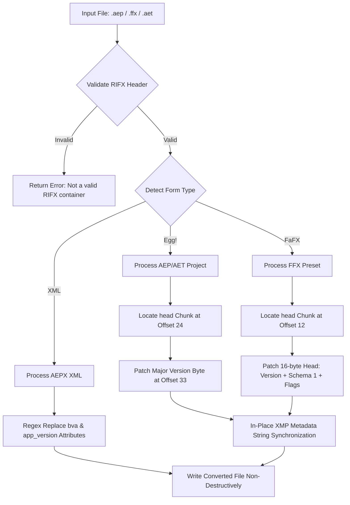

# After Effects Downgrader

<p align="center">
  <strong>Your After Effects projects. Across versions.</strong><br>
  Convert project (.aep, .aet, .aepx) and animation preset (.ffx) version metadata with precision.
</p>

<p align="center">
  <a href="https://dszae.github.io/After_effects_downgrade/"></a>
  <a href="https://github.com/Dszae/After_effects_downgrade/actions"></a>
  <a href="LICENSE"></a>
  <a href="#privacy"></a>
</p>

---

## ⚡ Quick Access

- 🌐 **Live Web Application:** [https://dszae.github.io/After_effects_downgrade/](https://dszae.github.io/After_effects_downgrade/)
- 💻 **Offline Execution:** Double-click [`index.html`](index.html) or run `python server.py`.
- ⌨️ **Command-Line Interface:** `python server.py input.ffx --target 2024`

---

## The Problem

When opening an Adobe After Effects project or preset created in a newer release, After Effects blocks loading with a version guard dialog:

> *"This project was created in a newer version of After Effects and cannot be opened."*

### Why Naive Approaches Fail
- **Plain-text search & replace** (e.g. replacing `"2026"` with `"2024"` in bytes) only touches appended XMP metadata text. After Effects ignores this text when checking compatibility and continues to reject the file based on the binary container header.
- **Blind byte replacement** corrupts container FourCC chunk headers (such as accidentally replacing `0x61` in `'FaFX'` or `'head'`).
- **Incomplete preset patching** leaves stream schema flags set to newer versions (e.g. Schema 5), causing After Effects 2024/2023 to silently drop all effect streams without error.

### What This Tool Does (and Doesn't Do)
- **What it does:** Accurately rewrites the big-endian `RIFX` container version integer, aligns the preset stream schema version (Schema 1), and synchronizes embedded XMP XML metadata. This allows older versions of After Effects to load the project or preset.
- **What it cannot do:** This tool cannot backport features or plugins that do not exist in the older After Effects installation. If a composition relies on newly introduced 3D model features or third-party plugins that are not installed on the target workstation, After Effects will flag missing effects.

---

## Features

- **Binary RIFX Container Engine:** Big-endian chunk traversal targeting exact `head` offsets in `Egg!` (Project) and `FaFX` (Preset) containers.
- **Multi-Format Support:**
  - **`.aep`**: Binary project files.
  - **`.aet`**: Project template files.
  - **`.ffx`**: Animation preset packs.
  - **`.aepx`**: XML project files (in-place attribute rewriting).
- **Preset Stream Schema Alignment:** Rewrites preset schema versions to `0x01` (`01 02 00 00`), preventing After Effects from silently ignoring effect streams.
- **100% Client-Side Privacy:** Web app processes files entirely in memory via HTML5 TypedArrays (`ArrayBuffer`). Files never leave your local machine.
- **Zero-Dependency Python CLI:** Headless conversion, diagnostic inspection (`--info`), and recursive directory batch processing using the Python standard library.
- **Database of 139 Adobe Build Signatures:** Target specific workstation release profiles (Windows, Apple Silicon ARM64, Intel Mac).
- **Offline ZIP Export:** Batch download converted presets as a packaged ZIP archive via bundled JSZip.
- **Binary Difference Inspector:** Live before/after byte diff table and hex dump viewer for technical transparency.

---

## Quick Start

### 1. Browser (Zero Installation)
Open the [Live Web Application](https://dszae.github.io/After_effects_downgrade/) in Chrome, Edge, Firefox, or Safari. Alternatively, open [`index.html`](index.html) directly from your local filesystem.

### 2. Local Server
Run the local server script:
```bash
python server.py
```
This automatically launches your default browser at `http://localhost:8000`.

### 3. Command-Line Interface (CLI)

```bash
# Downgrade an animation preset (.ffx) to AE 2024
python server.py samples/pixel_source_2026.ffx --target 2024 -o pixel_2024.ffx

# Downgrade a project (.aep) to AE 2023
python server.py commercial_edit.aep --target 2023

# Inspect file metadata without modifying
python server.py project.aep --info

# Recursively batch convert an entire folder of presets
python server.py --batch "C:\Presets\Pack" --target 2024
```

---

## Supported Versions & Matrix

| Release | Version | Binary Byte | Target Status | Stability Tier |
| :--- | :--- | :--- | :--- | :--- |
| **After Effects 2026** | v26.x | `0x61` (97) | Source Only | Modern RIFX |
| **After Effects 2025** | v25.x | `0x60` (96) | Supported | Fully verified |
| **After Effects 2024** | v24.x | `0x5F` (95) | **Recommended Default** | Peak cross-studio compatibility |
| **After Effects 2023** | v23.x | `0x5E` (94) | Supported | Fully verified |
| **After Effects 2022** | v22.x | `0x5D` (93) | Supported | Fully verified |
| **After Effects 2021** | v18.x | `0x5C` (92) | Supported | Expressions require testing |
| **After Effects 2020** | v17.x | `0x5B` (91) | Supported | Expressions require testing |
| **After Effects CC 2019**| v16.x | `0x5A` (90) | Experimental | Legacy structure |
| **After Effects CC 2018**| v15.x | `0x59` (89) | Experimental | Legacy structure |

Detailed technical breakdown available in [`docs/supported-versions.md`](docs/supported-versions.md).

---

## How It Works



### Binary Container Details
- **Projects (`Egg!`)**: The `head` chunk (size 20 bytes) begins at offset 24. Offset 33 (`head_data[1]`) stores the major version byte according to $\text{Byte} = \text{0x5B} + (\text{Version} - 20)$.
- **Presets (`FaFX`)**: The `head` chunk (size 16 bytes) begins at offset 12. Bytes 24..27 contain the big-endian version integer. Bytes 28..31 contain the stream schema version (`0x00000001`), and bytes 32..35 hold format flags (`0x01020000`).
- **XMP Synchronization**: Because release years are always four characters (`2026` &rarr; `2024`), in-place replacement leaves container byte offsets unchanged.

Detailed specifications are documented in [`docs/architecture.md`](docs/architecture.md).

---

## Applying Downgraded Presets in After Effects

When applying converted presets (`.ffx`):
1. **Ensure a Layer is Selected:** In After Effects, presets containing effect filters (`ADBE Effect Parade`) cannot be applied unless a layer (such as an **Adjustment Layer** `Ctrl+Alt+Y` or **Solid** `Ctrl+Y`) is highlighted in blue in the timeline. If no layer is selected, the command is ignored.
2. **View Effect Controls:** Check the **Effect Controls** panel (`F3` or `Window > Effect Controls`) to see the applied effect parameters.

Refer to [`docs/limitations.md`](docs/limitations.md) for full details.

---

## Performance & Testing

The repository includes an automated regression test suite testing container generation, binary boundary validation, and real sample conversion:

```bash
python -m unittest discover -s tests -v
```

```text
test_canonical_pixel_ffx (test_converter.TestAfterEffectsDowngrader) ... ok
test_downgrade_aep (test_converter.TestAfterEffectsDowngrader) ... ok
test_downgrade_ffx (test_converter.TestAfterEffectsDowngrader) ... ok
test_inspect_aep (test_converter.TestAfterEffectsDowngrader) ... ok
test_inspect_ffx (test_converter.TestAfterEffectsDowngrader) ... ok
test_malformed_files (test_converter.TestAfterEffectsDowngrader) ... ok
test_version_mapping (test_converter.TestAfterEffectsDowngrader) ... ok

Ran 7 tests in 0.053s (OK)
```

- **Processing Speed:** In-memory conversion completes in under 15ms per file.
- **Browser Compatibility:** Works across modern Evergreen browsers supporting `DataView` and `TypedArray` APIs.
- **Dependencies:** Zero external dependencies for core functionality (CLI requires standard Python 3.8+).

---

## Privacy Guarantee

- **Zero Network Transmission:** All conversions are executed locally in memory.
- **No Telemetry:** No analytics, tracker pixels, or cookies are included.
- **Offline Capable:** Works without an active internet connection.

See [`SECURITY.md`](SECURITY.md) for our full security and privacy policy.

---

## Documentation Index

- 📐 **[Architecture Specification](docs/architecture.md)** — Binary container structure and chunk specifications.
- 📊 **[Supported Versions Matrix](docs/supported-versions.md)** — Version bytes, compatibility tiers, and build IDs.
- 💻 **[CLI Usage Guide](docs/cli-usage.md)** — Command options, argument parsing, and automation recipes.
- ⚠️ **[Technical Limitations](docs/limitations.md)** — Version lock bypass vs feature backporting.
- 🛣️ **[Roadmap](ROADMAP.md)** — Completed, in-progress, and planned developments.
- 🤝 **[Contributing Guidelines](CONTRIBUTING.md)** — Bug reporting and contribution workflows.
- 📜 **[Changelog](CHANGELOG.md)** — Detailed version history.

---

## Author

Created and maintained by **Dipesh Sapkota**:

- **Portfolio**: [dipeshsapkota7.com.np](https://www.dipeshsapkota7.com.np/)
- **GitHub**: [@Dszae](https://github.com/Dszae)
- **Instagram**: [@dsz.ae](https://instagram.com/dsz.ae)
- **X (Twitter)**: [@dszAe18](https://x.com/dszAe18)
- **YouTube**: [@dsz.ae](https://youtube.com/@dsz.ae)
- **LinkedIn**: [dipeshsapkota7](https://linkedin.com/in/dipeshsapkota7)

---

## License

This project is licensed under the [MIT License](LICENSE).
