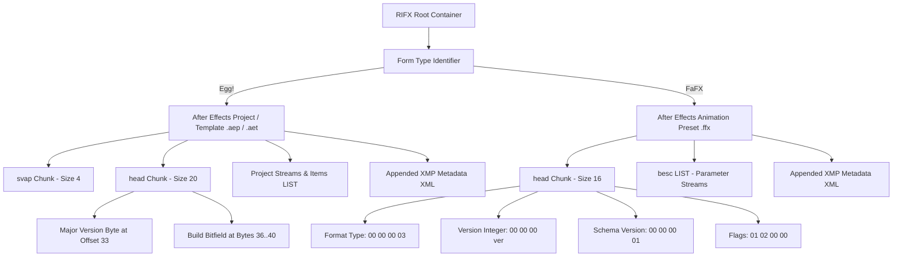

# Architecture & Binary Specification

This document details the internal binary architecture of Adobe After Effects project and preset files, and the container patching methodology utilized by this project.

---

## 1. Container Overview: Big-Endian RIFX

Adobe After Effects formats its binary projects (`.aep`, `.aet`) and animation presets (`.ffx`) using **RIFX** (Resource Interchange File Format with Big-Endian byte ordering). Unlike standard RIFF files (which use Little-Endian integers), all chunk length and integer header descriptors in RIFX use network byte order (Big-Endian).



---

## 2. After Effects Project Specification (`.aep` / `.aet`)

### Root Container
- **Offset `0x00..0x03`**: Magic FourCC signature `RIFX` (`0x52 0x49 0x46 0x58`).
- **Offset `0x04..0x07`**: Big-endian uint32 container length.
- **Offset `0x08..0x0B`**: FourCC Form Type `Egg!` (`0x45 0x67 0x67 0x21`). "Egg" was the original internal codename for CoSA After Effects 1.0.

### Chunk Structure
1. **`svap` Chunk** (offset `0x0C`): 4-byte chunk size + 4-byte data.
2. **`head` Chunk** (offset `0x18`, index 24):
   - FourCC: `head` (`0x68 0x65 0x61 0x64`).
   - Chunk Data Size: uint32 = 20 (`0x00 0x00 0x00 0x14`).
   - Data payload begins at offset `0x20` (index 32).
   
### Major Version & Build Bitfield
- **Offset `0x21` (index 33, `head_data[1]`)**:
  Major version byte. The formula correlating the byte value to the release year is:
  $$\text{Version} = \text{Byte} - \text{0x5B} + 20$$
  - `0x61` = AE 2026 (v26.x)
  - `0x60` = AE 2025 (v25.x)
  - `0x5F` = AE 2024 (v24.x)
  - `0x5E` = AE 2023 (v23.x)
  - `0x5D` = AE 2022 (v22.x)
  - `0x5C` = AE 2021 (v18.x)
  - `0x5B` = AE 2020 (v17.x)
- **Offset `0x24..0x27` (bytes 36..40, `head_data[4..8]`)**:
  32-bit build info structure:
  - Bits `1..5` and `10..12`: Major version.
  - Bits `6..9`: Platform OS (`1100` = Windows, `1101` = Mac Intel, `1110` = Mac ARM64 Apple Silicon).
  - Bits `13..16`: Minor version.
  - Bits `17..20`: Patch version.
  - Bit `22`: Release flag (`1` = Release build, `0` = Beta).
  - Bits `24..31`: Build number.

---

## 3. After Effects Preset Specification (`.ffx`)

### Root Container
- **Offset `0x00..0x03`**: Magic FourCC `RIFX`.
- **Offset `0x04..0x07`**: Big-endian uint32 container length.
- **Offset `0x08..0x0B`**: FourCC Form Type `FaFX` (`0x46 0x61 0x46 0x58`).

### `head` Chunk Layout (Offset `0x0C`, index 12)
- Chunk Header: FourCC `head` + uint32 length `0x00 0x00 0x00 0x10` (16 bytes data).
- Data payload starts at offset `0x14` (index 20):
  - **Bytes `0..3` (`0x14..0x17`)**: Container sub-format identifier = `0x00 0x00 0x00 0x03`.
  - **Bytes `4..7` (`0x18..0x1B`, index 24..27)**: Big-endian version integer. Byte 27 holds the target version byte (`0x5F` for AE 2024).
  - **Bytes `8..11` (`0x1C..0x1F`, index 28..31)**: Preset Stream Schema Version. Must be `0x00 0x00 0x00 0x01` for compatibility with AE 2024/2023. Presets saved from newer builds (e.g. Schema 5) will be skipped by older stream parsers if left unpatched.
  - **Bytes `12..15` (`0x20..0x23`, index 32..35)**: Flags = `0x01 0x02 0x00 0x00`.

---

## 4. XMP XML Metadata Synchronization

Appended at the end of `.aep` and `.ffx` files is an Adobe XMP packet:
```xml
<?xpacket begin="..." id="W5M0MpCehiHzreSzNTczkc9d"?>
<x:xmpmeta xmlns:x="adobe:ns:meta/">
  <rdf:RDF xmlns:rdf="http://www.w3.org/1999/02/22-rdf-syntax-ns#">
    <rdf:Description ...>
      <xmp:CreatorTool>Adobe After Effects 2026 ...</xmp:CreatorTool>
      <stEvt:softwareAgent>Adobe After Effects 2026 ...</stEvt:softwareAgent>
    </rdf:Description>
  </rdf:RDF>
</x:xmpmeta>
```

When downgrading, the engine performs an in-place string replacement (`"Adobe After Effects 2026"` &rarr; `"Adobe After Effects 2024"`). Because all release years use four ASCII characters, the byte length of the file remains 100% constant, avoiding any pointer invalidation in RIFX stream offsets.
